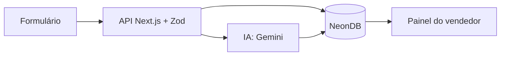

# LeadScore IA

Qualificador inteligente de leads para pequenas empresas. O lead preenche um formulário, a IA avalia o potencial de compra (nota de 0 a 100, classificação quente/morno/frio) e sugere uma resposta de follow-up para o vendedor.

**Trabalho de Inteligência Artificial · FAETERJ Barra Mansa · Professor Vinicius**
**Trio:** [Isabele Souza], [Guilherme Nunes] e [Yasmin Sanglard]

🔗 **Aplicação:** [link da Vercel]
🔗 **Repositório:** (https://github.com/yasminSanglard02/Prova_IA.git) 

## O problema
Pequenas empresas recebem contatos por site e WhatsApp e não sabem quais priorizar. O vendedor perde tempo com leads frios e demora a responder os quentes.

## A solução
1. O lead preenche o formulário.
2. A API valida os dados e salva no banco.
3. A IA analisa a mensagem e devolve nota, classificação, justificativa e uma resposta sugerida.
4. O painel mostra os leads ordenados por nota, com botão para copiar a resposta e para reanalisar.

## Arquitetura



## Stack

| Camada | Tecnologia |
|---|---|
| App (front e back) | Next.js (App Router) + TypeScript |
| Estilo | Tailwind CSS |
| Banco | Neon (PostgreSQL serverless) |
| ORM | Drizzle ORM |
| Validação | Zod |
| IA no produto | Gemini API (`gemini-3.8-flash`) |
| Deploy | Vercel |
| Versionamento | GitHub |

## Modelo de dados
- **leads:** nome, e-mail, empresa, segmento, mensagem, origem, data.
- **analises:** lead_id, score (0 a 100), classificacao, justificativa, resposta_sugerida, modelo, data.

A análise fica em tabela separada. Isso permite reanalisar um lead e manter o histórico das avaliações da IA. O painel mostra sempre a mais recente.

## Rotas da API
| Método | Rota | O que faz |
|---|---|---|
| POST | `/api/leads` | Valida e salva um lead |
| POST | `/api/analisar/[leadId]` | Analisa o lead com a IA e salva em `analises` |

## Como rodar localmente

```bash
git clone [link do repositório]
cd leadscore-ia
npm install --legacy-peer-deps
cp .env.example .env.local     # preencher as variáveis abaixo
npx drizzle-kit push           # cria as tabelas no Neon
npm run seed                   # cria 10 leads de teste
npm run dev
```
Abra `http://localhost:3000` (formulário) e `http://localhost:3000/painel` (painel).

## Variáveis de ambiente

| Variável | Descrição |
|---|---|
| `DATABASE_URL` | Connection string do Neon |
| `GEMINI_API_KEY` | Chave da Gemini API (aistudio.google.com) |
| `MOCK_IA` | `true` usa análise simulada, sem chamar a API |

O arquivo `.env.local` não vai para o GitHub.

## Decisões técnicas
- **Resposta da IA em JSON validado com Zod** antes de salvar. Se vier inválido, o código tenta de novo.
- **Tentativas com espera** e, se a API estiver fora do ar, uma análise simulada (`modelo: "mock (fallback)"`), para o lead nunca ficar sem nota.
- **Modo mock** (`MOCK_IA=true`) para desenvolver sem depender da API.
- **Tabela de análises separada** para manter o histórico.

## Divisão do trabalho
- **Isabele Souza:** banco de dados (schema Drizzle e Neon), rota `POST /api/leads` e testes com o seed.
- **Yasmin Sanglard:** integração com a IA (`analisarLead.ts`), prompt do classificador, rota `POST /api/analisar/[leadId]` e tratamento de erros.
- **Guilherme Nunes:** formulário, painel de leads, deploy na Vercel e documentação (README e relatório).

## Como usamos IA no desenvolvimento
[Claude e Use.ia auxiliaram]

## Dificuldades e soluções
- **Conflito de dependências no npm:** resolvido com `--legacy-peer-deps`.
- **Modelo do Gemini descontinuado (erro 404):** troca do nome do modelo.
- **Erro 503 por alta demanda da API:** tentativas com espera e fallback para análise simulada.

## Limitações e melhorias futuras
- Login para acesso ao painel.
- Filtro por classificação e data.
- Gráfico de leads por classificação.
- Exportação de leads em CSV.
